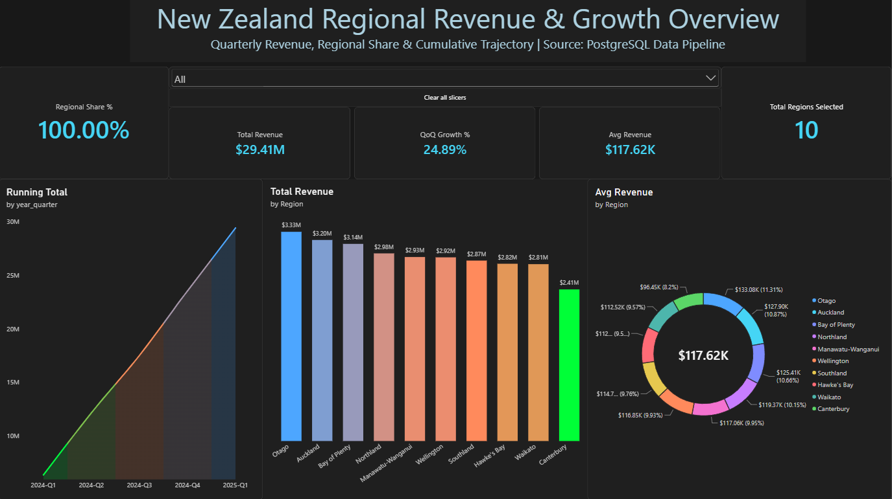

# New Zealand Regional Revenue & Growth Analytics Pipeline

An end-to-end data engineering and business intelligence solution that ingests regional economic metrics into a **PostgreSQL 18** star schema via Python and visualizes quarterly revenue, regional share, and cumulative growth trajectories in **Power BI**.



---

## Project Architecture

```text
Raw Data Source ──▶ Python ETL (db_loader.py) ──▶ PostgreSQL 18 (nz_pipeline_db) ──▶ Power BI Executive Dashboard
```

### Data Model (Star Schema)
* **`fact_regional_metrics`**: Core fact table storing quarterly metric values (`metric_value`), foreign keys (`region_id`, `category_id`), and reporting periods (`year_quarter` from `2024-Q1` to `2025-Q1`).
* **`dim_region`**: Dimension table mapping 10 New Zealand regions (Auckland, Canterbury, Otago, Waikato, Wellington, Bay of Plenty, Hawke's Bay, Manawatu-Wanganui, Northland, Southland).
* **`dim_category`**: Dimension table categorizing regional performance metrics.

---

## Key DAX Measures & Analytics

Built with modern DAX window and filter-context functions for dynamic executive reporting:

* **Total Revenue**: Core aggregation of regional metric volume (`$29.41M` across all regions).
* **Avg Revenue**: Average metric value across selected dimensions (`$117.62K`).
* **Regional Share %**: Dynamic proportional contribution using `REMOVEFILTERS(dim_region)` to evaluate regional market share against the grand total.
* **QoQ Growth %**: Quarter-over-quarter momentum (`24.89%`) computed using modern DAX window functions (`OFFSET`).
* **Running Total**: Cumulative revenue trajectory across quarters using `WINDOW(1, ABS, 0, REL, ...)` ordered chronologically by `year_quarter`.

---

## Tech Stack
* **Database**: PostgreSQL 18 (`nz_pipeline_db`)
* **ETL / Ingestion**: Python (`db_loader.py`, `psycopg2`, `pandas`)
* **BI & Visualization**: Microsoft Power BI Desktop (Dark Theme Executive Layout, Custom DAX Measures, Interactive Slicers)

---

## Repository Structure

```text
├── images/
│   └── Dashboard Preview.png    # Full-screen capture of the Power BI dashboard
├── db_loader.py                 # Python ETL script for schema setup and data loading
├── NZ-Data-Pipeline.pbix        # Power BI Desktop report file
├── requirements.txt             # Python dependencies
├── .gitignore                   # Git ignore rules for credentials and cache files
└── README.md                    # Project documentation
```

---

## How to Run Locally

1. **Clone the repository**
   ```bash
   git clone https://github.com/Satnam-Singh-Analyst/NZ-Data-Pipeline.git
   cd NZ-Data-Pipeline
   ```

2. **Set up PostgreSQL Database**
   * Create a database named `nz_pipeline_db` in PostgreSQL 18.
   * Set your database credentials via environment variables (`DB_HOST`, `DB_USER`, `DB_PASSWORD`) or update the configuration in `db_loader.py`.

3. **Install Dependencies & Load Data**
   ```bash
   pip install -r requirements.txt
   python db_loader.py
   ```

4. **Open the Power BI Dashboard**
   * Open `NZ-Data-Pipeline.pbix` in Power BI Desktop.
   * Click **Refresh** on the Home ribbon and enter your local PostgreSQL credentials if prompted.
